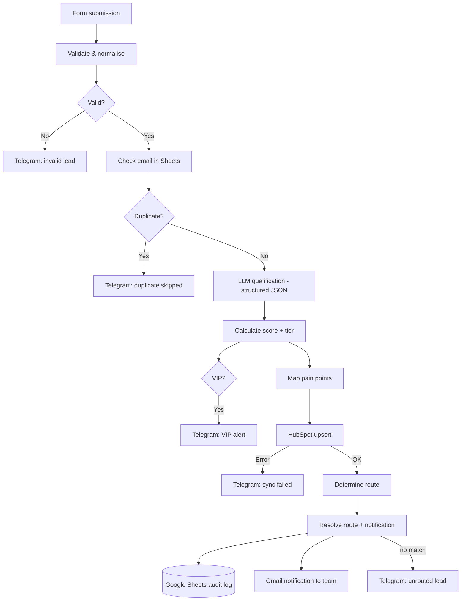

# AI Lead Qualification & CRM Router

An n8n workflow that takes an inbound B2B lead from a web form to a **validated, de-duplicated, AI-qualified, scored, CRM-synced and routed** contact, with admin alerts and an audit log. No spreadsheet shuffling by hand.

**Stack:** n8n · LLM via OpenRouter (OpenAI-compatible node) · HubSpot · Google Sheets · Gmail · Telegram
**Size:** 29 nodes — 1 Form Trigger · 8 Code · 3 IF · 1 Switch · LLM chain + chat model + structured output parser · 1 HubSpot HTTP request · 2 Google Sheets · 5 Gmail · 5 Telegram

## What it does

1. **Intake** — an n8n Form Trigger receives name, email, company, industry, budget, timeline and need.
2. **Validate & normalise** — trims fields, lower-cases the email, checks required fields and email syntax. Invalid leads stop here and trigger a Telegram admin alert.
3. **De-duplicate** — looks the email up in the Google Sheets audit log. Duplicates are skipped with a Telegram alert.
4. **AI qualification** — an LLM chain with a **structured output parser** returns JSON: ICP fit, buying intent, budget, authority, need, timeline, pain points, summary and next best action.
5. **Score** — plain JavaScript turns those fields into a 0–100 score and a `HOT` / `WARM` / `COLD` tier. The model never picks the number.
6. **VIP check** — score ≥ 90 **or** budget `$5,000+` fires an extra Telegram alert.
7. **HubSpot** — upserts the contact by email through the CRM batch-upsert API (3 retries); failures raise a Telegram alert.
8. **Route** — HOT leads go to SaaS / E-commerce / General sales by industry, WARM to nurture, COLD to marketing. Unmatched leads raise an "unrouted" alert.
9. **Log & notify** — appends a row to the Google Sheets audit log and sends the team a Gmail notification.

> **Design choice:** the LLM *interprets* the lead; deterministic code decides score and route. The result is explainable, testable and repeatable.

## Scoring model

| Factor | Max | Rule |
|---|---:|---|
| ICP fit | 20 | `Yes` = 20, otherwise 0 |
| Authority | 15 | High 15 · Medium 10 · Low 5 |
| Budget | 20 | High 20 · Medium 12 · Low 5 |
| Need | 20 | High 20 · Medium 12 · Low 5 |
| Timeline | 15 | Immediate / ≤ 1 month 15 · 1–3 months 12 · 3–6 months 8 · 6+ months 3 |
| Problem clarity | 10 | At least one pain point = 10 |
| **Total** | **100** | `HOT` ≥ 80 · `WARM` 50–79 · `COLD` < 50 |

## Routing

| Tier / industry | Route | Notification |
|---|---|---|
| HOT + SaaS | `HOT_SaaS` | SaaS sales email |
| HOT + E-commerce | `HOT_Ecommerce` | E-commerce sales email |
| HOT + other | `HOT_General` | General sales email |
| WARM | `WARM` | Nurture email |
| COLD | `COLD` | Marketing nurture email |

## Repository contents

| Path | Description |
|---|---|
| `workflow/Lead Qualification & CRM Router.json` | n8n export. Credentials, IDs, emails and chat IDs replaced with placeholders. Imports as **inactive** |
| `docs/test-cases.md` | End-to-end test scenarios with expected results |
| `screenshots/workflow-overview.png` | Diagram of the 29 nodes |

## Setup

1. n8n → **Workflows → Import from file** → choose the JSON.
2. Attach your own credentials to each external node: LLM (OpenRouter via the OpenAI node), Google Sheets, Gmail, Telegram, HubSpot (`HTTP Header Auth`: `Authorization: Bearer <private-app-token>`).
3. Replace placeholders: `YOUR_TELEGRAM_CHAT_ID` in the five Telegram nodes, and the notification addresses (`user@example.com`) inside the **Resolve Route & Notification** Code node.
4. Create a Google Sheet with a `Leads` tab; the Append node expects these columns: `Processed At, First Name, Last Name, Email, Company, Company Industry, Lead Score, Lead Tier, Route, ICP Fit, Buying Intent, Budget Level, Authority Level, Need Level, Timeline, Pain Points, Qualification Summary`. Select your Sheet in both Sheets nodes.
5. Create the HubSpot contact properties: `lead_score`, `lead_tier`, `buying_intent`, `icp_fit`, `budget_level`, `authority_level`, `pain_points`, `ai_qualification_summary`.
6. Run the scenarios in [`docs/test-cases.md`](docs/test-cases.md) before activating.

Never commit API keys, tokens or real lead data.

## Known limitations

Documented so the next iteration is obvious:

- `buying_intent` is stored and sent to HubSpot but adds no points to the score.
- VIP uses **OR**: a `$5,000+` budget triggers the VIP alert even when the score is below `HOT`.
- Invalid and duplicate submissions are alerted on Telegram but are not written to the audit sheet.
- Notification recipients and the admin chat ID are hard-coded; move them to n8n variables for production.
- All routes currently send to a single placeholder address until real team inboxes are configured.

## License

MIT
